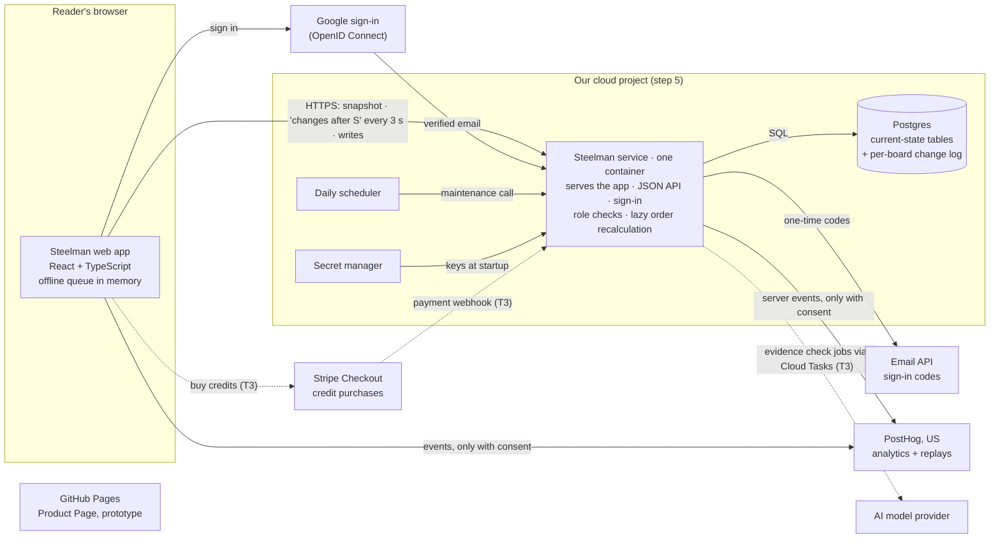

# Steelman architecture

**Status:** draft, written one step at a time. Steps 1–7 were approved on Nov 11. An independent review the same day then revised them and added step 8; the builder approved the revisions that day (Q19). An interview with the builder that evening settled the questions still open: who merges (Q18), email sign-in by code instead of link (Q21), the "edited" mark (Q22), shared-source edits (Q10), joining by link (Q7), staging's database (Q16), and the domain (Q13). What the review changed: live updates read stamped rows instead of a log of every vote (§2, §3); writes are safe to repeat by their shape (§2); the delivery pipeline no longer touches staging from a pull request (§6); and testing and unattended agent work have their own section (§8). The phased build plan is in `plans/build-plan.md`.

This document describes the real product that replaces the browser-local prototype. The prototype (`docs/prototype/source/steelman-refined.html`) is the design spec; `plans/features.csv` is the feature record. **MVP = T1 Core + T2 Launch: 31 features.**

---

## 1. Requirements and constraints

### What the product must do (functional)

Grouped by the jobs the MVP has to do. Feature IDs are from `plans/features.csv`.

| # | Requirement | Features |
|---|---|---|
| F1 | **Build a board.** Create a question with 2–4 options. Add arguments to an option; add alternative wordings (versions) to an argument. Each version records its author. | F-01, A-02, A-03, A-04, A-05, A-12 |
| F2 | **Edit like Reddit.** An author can edit or delete their own version at any time. An edited version says "edited" and keeps every earlier wording. | A-06 |
| F3 | **Three separate judgments.** Importance: +1/−1 per person per argument. Articulation: +1/−1 per person per version (only when the argument has two or more). Credibility: yes/no per person per version. Each can be changed or withdrawn. One active judgment per person per target, always. | B-01, B-02, B-03, B-04 |
| F4 | **Sources.** Add, edit, and remove sources on a version. Any edit to the wording, and any change to its sources, starts that version's credibility assessments over. Importance and articulation votes stay. | C-01, B-03 |
| F5 | **Shared order, held still.** The server computes one shared order from votes. A reader's order is fixed when the board loads. Others' votes update counts in place; new arguments and wordings join the end; deletions and edits show in place, marked; "N changes · Update" applies the rest. Drafts follow their argument. Your own actions queue while offline and send when you reconnect, for as long as the tab stays open (step 3). | B-05, M-02 |
| F6 | **Strongest case.** Each option's top three arguments, each in its best-articulated wording. Derived, never stored by hand. | E-01 |
| F7 | **Accounts without passwords.** Sign in with Google or a 6-digit code sent by email; both confirm the email. First sign-in picks a unique username. Change email (confirmed by a code sent to the new address), connect or disconnect Google, sign out. | L-01, L-04 |
| F8 | **Access and roles, enforced on the server.** General access: only invited people, or anyone with the link (with a role). Roles Viewer → Voter → Contributor → Editor → Owner, as in `plans/permissions.md`. A link-shared board requires a confirmed email. Every write is checked on the server, not just hidden in the UI. | H-02, H-03 |
| F9 | **Moderation.** Report a version or comment (with a reason). Editors and moderators hide with a reason and restore. Every moderation action is recorded (who, what, when, why) in an append-only audit trail from day one, even though the History panel that shows it is T3. | J-01, J-02 |
| F10 | **Find your boards.** A list of the steelmen you can see, newest first. | E-03 |
| F11 | **Links.** Every board, version, and comment has a stable address. A link to something deleted or hidden says so instead of breaking. | M-06 |
| F12 | **Privacy.** Analytics notice with opt-out, Global Privacy Control and Do Not Track honored, choice stored per account as well as per browser. Download your data. Delete your account: email, votes, assessments, and comments are removed; arguments, wordings, and sources stay, credited to `deleted_account`. | M-07, M-08 |
| F13 | **Front-end only, but required.** Board layout, phone layout, accessibility, design tokens, onboarding tour (one "seen" flag per account). | A-01, M-03, M-04, M-05, L-02 |

**Designed for now, built later.** The data model and API must not paint these into a corner, but the MVP doesn't build them:

- Combine and separate with stable version IDs, plus structural undo from history (A-10, J-03, J-04).
- Comment threads (D-01). Comments are in F11 and F12 only as link targets and as data to delete.
- Invites by username or email, spaces, and public communities (H-01, G-01–G-07).
- Scheduled closing (I-05), notifications by email (L-06, L-07).
- The AI evidence check with credits per space (K-02, K-04): the first real model call.

### How well it must do it (non-functional)

| Quality | Class trial (start) | Public communities (later) |
|---|---|---|
| **People** | One group of ~30, a handful of boards | Thousands of accounts across many communities |
| **At the same time** | ≤ 30 on one board | A few hundred on the busiest board |
| **Board size** | Tens of arguments | Up to ~200 arguments per option, ~12 wordings per row (the prototype's at-scale folds) |
| **Write rate** | A few votes a second at a class-wide peak | Tens of votes a second at peak; still small for one Postgres database |
| **Your own action** | Saved and acknowledged in under 0.5 s (p95) | Same |
| **Others' changes** | Counts and the "N changes" pill within ~5 s | Within ~2 s |
| **Availability** | Best effort; up during class hours. One region, no failover. Planned downtime outside class is fine | ~99.5% monthly. Still one region |
| **Data loss** | At most a few minutes of writes (point-in-time recovery) | Same |
| **Restore time** | Same day | Within a few hours |
| **Running cost** | Hosting and database paid by the builder: keep it as low as practical (single-digit to low tens of dollars a month) | Same rule; grows with use but stays small |
| **AI cost** | Off by default on every board. No AI spend the builder absorbs | Paid by users through credit purchases, metered per space |
| **Privacy** | US hosting. Email is the only personal data we hold beyond what people write. No analytics on typed text. Export and deletion work for real | Same, plus the privacy page reviewed before public launch |
| **Abuse** | Not a concern within one class | Rate limits per account and per IP; new-member holds are an option (permissions.md open question) |

**Why the latency targets are loose.** Because the order is held still, nobody's layout moves when others vote. "Live" only has to keep counts fresh and tell readers that changes are waiting. A few seconds' delay is invisible in that design, which is what lets us start simple (decided in step 3).

### Constraints

- **Team:** one builder, with Claude writing the code. Development time is not the constraint; the builder's ability to understand, review, and operate the system is. Every component has to be something the builder can explain, run locally, and fix alone. Fewer moving parts beats elegance. Plans are sized by scope, not hours.
- **Attention:** the builder is not on this full time or part time. Agents build it piece by piece, mostly unattended. So the builder can't be the check on every change: **the automated tests are.** Every rule in this document needs a test that fails when the rule is broken, the whole suite has to run from one command with no accounts and no network, and the few things only a person can do are listed once so they can be done in a batch (§8).
- **Money:** the builder pays for hosting and the database. Anything with a per-use cost (AI) is passed on to users through credit purchases, so AI can't be switched on for real users until purchases exist.
- **Course schedule:** Build 2 (due **Nov 16, 2026**) asks for the smallest *local* working version that tests the riskiest part, plus its architecture, budget, and security checklist (`Plan.md`).
- **Starting point:** a buildless, single-file prototype and static GitHub Pages. No backend exists yet.
- **Fixed choices:** PostHog (US cloud) stays; no passwords; AI never casts counted votes or reorders; GCP or AWS for hosting; portable building blocks (containers, Postgres, OAuth/OIDC, infrastructure as code).
- **Secrets:** none in the repository; `.env.example` locally, a secret manager in the cloud.

### The riskiest technical problem

**Keeping every reader's held-still view consistent with a shared order that keeps changing underneath it.**

Each reader holds an old snapshot. Meanwhile other people vote, add, edit (which resets credibility), and delete; later, combine and separate. The server has to:

1. tell each reader how far their snapshot is behind ("3 changes") without sending them a new layout;
2. apply the right changes, and only those, when they choose **Update**;
3. accept actions a reader queued offline against a snapshot that may now be stale: a vote on a version that was deleted or combined away, or a credibility assessment of wording that has since been edited.

If this goes wrong, the failure is silent and corrosive: counts that disagree between two people, a vote landing on the wrong wording, an assessment surviving an edit it never judged. Votes are the product, so this matters more than any other risk.

Everything else is well-trodden: sign-in (a hosted provider), CRUD on boards, role checks, export and deletion.

**How the architecture tests it first.** The first milestone is a thin slice that does nothing else:

- One board, the T1 data, and a **per-board change number**: every write takes the board's next number and stamps it on the rows it touched. A reader's snapshot is "the board as of change N"; what's new is every row stamped after N. (Step 2 settles the details; step 3 the transport.)
- Every write that targets a version names the **revision** it was made against. The server rejects or redirects stale ones by explicit rules (vote on a deleted version → dropped and reported; assessment of an old revision → dropped and reported) instead of guessing.
- Acceptance tests come in two kinds (§8). A **simulation** plays thousands of random sequences of readers voting, editing, deleting, going offline, and coming back, and checks after every step that the counts are right and that every reader ends up with the same board. And the scenarios already written in `tests/build-1-manual.md` (November 11, *Live changes* and *Live changes, structure*) run as browser tests with two or three sessions.

Sign-in, the list, moderation, and the rest are built only after this slice passes. Build 2's "smallest local version" is this slice.

**Runner-up risks, and what the design does about them:**

- **Email sign-in that breaks in a classroom.** A one-time link has two problems at a school. Mail systems often open every link in an incoming email to check it for malware, which uses the link up before the person clicks it. And a link signs in the device that opened it: a classmate reading email on a phone ends up signed in on the phone, not the laptop they're working on. So the email carries a **6-digit code** to type into the page that's already open (Q21). There is nothing to click, so nothing for a scanner to use up, and it signs in the right device.
- **Google sign-in blocked by a school's Google Workspace.** Workspace admins can block sign-in to apps they haven't approved. The email code is always available as the fallback (the prototype has this fallback, as a link), and the first real test should be a classmate's school account.
- **Edits used to game the judgments.** Because any edit keeps importance and articulation votes, an author could collect votes on a strong wording and then change what it says. Because any edit also resets credibility, an author could wipe unfavourable assessments with a trivial edit. Neither changes the decided rules, but the data model keeps every earlier wording *and* the assessments it received, so the product can show "edited after 40 votes" and "before this edit: 3 of 17 found it supported". Decided (Q22): the "edited" mark explains itself on hover, or on tap on a phone, including how many importance and articulation votes the wording had before the edit. Each revision stores those two counts for that purpose.

---

## 2. Data model

### The shape in one paragraph

Everything lives in **one Postgres database**. A small set of tables hold the **current state** of each board (options, arguments, versions, votes, sources). Every board has a **change number** that goes up by one with each write, and every row a write touches is **stamped** with that number, in the same transaction. Next to the tables is an **append-only change log** with one row per structural or moderation action: who did what, when, and why. The tables answer "what does the board look like now?" and, through the stamps, "what has changed since change N?" (live updates). The log answers "who did this?" (audit trail) and "how do I undo it?" (structural undo). **Votes are not logged**: the vote tables are their record. Scores, the shared order, and the strongest case are **derived** from the votes.

### Entities

Names follow the product, not the prototype: the prototype's `idea` is an **argument**, its `card` is a **version**.

| Entity | What it is | Key fields | Prototype origin |
|---|---|---|---|
| **account** | A person | `id`, `username` (unique, case-insensitive), `email` (unique; null once deleted), `email_confirmed_at`, `analytics_choice`, `tour_seen_at`, `deleted_at` | `state.me`, `state.myEmail` |
| **sign_in_method** | Google or email code, linked to an account | `account_id`, `provider`, `provider_subject` | `state.google` |
| **board** | One steelman: a question | `id` (unguessable; see Links), `question`, `created_by`, `general_access` (invited / link), `link_role`, `rules` (mode, which votes are on, AI switches), `closed_at`, `decision`, `last_seq` | `doc.question` |
| **board_member** | A person's role on a board | `board_id`, `account_id`, `role` (viewer … owner), `joined_via` (link / invite) | `question.people` |
| **option** | A side | `id`, `board_id`, `name`, `position`, `deleted_at` | `doc.options` |
| **argument** | A reason within an option, grouping its wordings. Carries **importance** | `id`, `board_id`, `option_id`, `created_by`, `merged_into` (null unless combined away), `status` (published / held / declined), `deleted_at`, `importance` (derived count) | `doc.ideas` |
| **version** | One wording of an argument. Carries **articulation** and **credibility** | `id` (**never changes**), `board_id`, `argument_id` (changes on combine / separate), `author_id`, `current_rev`, `status`, `hidden` (by, reason, at), `deleted_at`, `articulation`, `yes`, `no` (derived counts) | `doc.cards` |
| **version_revision** | Every wording a version has had | `version_id`, `rev` (1, 2, 3…), `wording`, `context`, `why` (created / edited / sources changed / a cited source changed), `counts_before` (the importance and articulation counts just before this revision replaced the last, shown on the "edited" mark), `by`, `at` | `card.prev` |
| **revision_source** | Which sources a revision cites | **key** (`version_id`, `rev`, `source_id`) | `card.sources` |
| **source** | A piece of evidence, shared on the board; one source can be cited by several versions | `id`, `board_id`, `name`, `locator` (URL or citation), `finding`, `backs_up`, `limits`, `added_by`, `unavailable` (reported by, at) | `doc.sources` |
| **importance_vote** | ±1 on an argument | **key** (`argument_id`, `account_id`), `board_id`, `value`, `at` | `idea.score`, `my` |
| **articulation_vote** | ±1 on a version | **key** (`version_id`, `account_id`), `board_id`, `value`, `at` | `card.pref` |
| **assessment** | Yes / no on whether the evidence backs the wording | **key** (`version_id`, `rev`, `account_id`), `board_id`, `supported`, `at` | `card.yes`, `card.no` |
| **comment** *(T3, modeled now)* | A note on the question, an option, or a version; threaded | `id`, `board_id`, `target`, `parent_id`, `author_id`, `body`, `resolved_at`, `hidden`, `deleted_at` | `doc.comments` |
| **report** | A flag on a version or comment | `id`, `board_id`, `target`, `reporter_id`, `reason`, `note`, `withdrawn_at`, `resolved` (by, how, at) | `card.reports` |
| **change** | One row per structural or moderation action, per board, in order: the change log. Votes and assessments are not in it | **key** (`board_id`, `seq`), `at`, `actor_id`, `kind`, `subject` (what it touched), `before` / `after` (only what's needed to show or undo it), `reason` | `doc.log` |

**On every row.** Each option, argument, version, source, and comment row also carries **`changed_seq`**: the board's change number when the row last changed, including a change to its counts. It's indexed with `board_id`, and it is what live updates read (step 3). Every table that belongs to a board carries `board_id`, and a row can only point at rows of the same board (the foreign keys include `board_id`). So "scoped to one board" is something the database checks, not only the code.

**Later, not in the MVP:** `space` and `space_member` (G), `invite` (H-01), `combine_suggestion` (A-11), `notification` (L-06), `ai_check` (K-02, attached to a version *revision*, like an assessment), and a `credit_ledger` per space (K-04). None of them changes the tables above; each adds a table and, at most, a nullable `space_id` on `board`.

Sources are text and links only. Uploading files isn't in the MVP; if it comes, the file goes to object storage and the `source` row keeps the link.

### Invariants: the rules the database enforces

1. **One judgment per person per target.** Each vote table's primary key is (target, person), so a second vote can only *replace* the first. Changing a vote is an update; withdrawing it deletes the row. No code path can create a duplicate.
2. **Credibility belongs to a revision.** An assessment is keyed to the version *and the revision it judged*. Editing the wording, or changing its sources, creates revision *n+1*. Editing a source that several versions cite does the same to each of them, but only when the evidence itself changed (its link, its finding, what it backs up, or its limits); fixing just the source's name resets nothing (Q10). In every case only assessments of the current revision count. Old assessments aren't deleted: they stay as history (PRD §4: "previous results remain in history"), but they stop counting. Importance and articulation votes don't mention revisions, so edits don't touch them. That is the whole reset rule, done by structure rather than by a cleanup job.
3. **Writes name what they were made against.** A request to assess carries the revision the person read. If it's no longer current, the server refuses it and returns the current version, and the client says "This wording changed; take another look." The same pattern catches votes on deleted or merged items (step 3 covers offline replay).
4. **A version's ID never changes.** Combining and separating move a version to another argument by changing its `argument_id`; the version, its revisions, its articulation votes, its assessments, its comments, and its link all stay attached. An argument combined away keeps its row with `merged_into` set, so its old links redirect to where its wordings went.
5. **Supported needs evidence.** "Yes" requires at least one cited source that isn't marked unavailable (PRD §4). Checked by the server.
6. **Deleted and hidden items keep their place.** A deleted or hidden option, argument, version, or comment keeps its row, so its link shows "That version was deleted" or "Removed by a moderator · Spam" instead of breaking. The two differ in what happens to the text:
   - **Deleted by its author:** the text is erased (every revision's wording and context, or the comment body) in the same transaction that marks it deleted. Like Reddit: deleting your post removes what you wrote. Votes on it stop counting. The ten-second **Undo** happens in the browser: it holds the delete for ten seconds and then sends it (at once if the tab is closing), so the server needs no timer and nothing erased ever has to be brought back.
   - **Hidden by a moderator:** the text is kept, so moderators can review it and **Restore** it.
7. **The change log never copies what people wrote, and holds no votes.** A change row points to things by ID (a version, a revision, a source), never wording, comments, or source text. So erasing text happens in one place, and the log can't leak it. Votes and assessments aren't in the log at all: the vote tables are the only place that links a person to a vote (see Q12).
8. **The change log is append-only.** The application's database user may *insert* into `change` but not update or delete. The one exception is account deletion, which runs under a separate database role to scrub an actor. This is what makes it a trustworthy audit trail.
9. **Every write takes the board's next change number, stamps the rows it touched, and (for a structural or moderation action) adds its change row, all in one transaction.** Taking the number locks the board's counter until the transaction commits, so writes to one board commit in number order. That is what makes "everything stamped after N" safe to ask: a reader who has seen change N can never later be handed a change numbered N or lower. The cost: writes to one board take turns, a few milliseconds each. That allows a few hundred writes a second per board, well above the busiest board in step 1. If a board ever gets close, votes are the writes to batch first (step 3).
10. **Every write is safe to send twice.** No write means "add one" or "flip"; each says what the result should be, so repeating it changes nothing (see Links and IDs). Retries and the offline queue depend on this.

### What's stored and what's derived

| Thing | Stored or derived | How |
|---|---|---|
| Votes and assessments | **Stored** (the truth) | The vote tables |
| Importance, articulation, yes/no counts | **Derived, cached on the row** | Updated in the same transaction as the vote, so they can't drift; can always be recomputed from the vote tables (a check in tests) |
| Credibility meter | Derived on read | yes ÷ (yes + no) for the current revision; "few" under 5 |
| "Edited" | Derived | `current_rev > 1` and the latest revision's `why` is an edit |
| **Shared order** | **Derived, but saved** | Sort by score; **ties keep the previous order**, and unassessed items stay at the end (PRD §7). Because ties depend on the *previous* order, the order isn't a pure function of the votes: each recalculation is saved with the change number it was computed at. Only the newest is kept (one row per board, replaced each time): no reader ever needs an older one. Cadence is step 3 |
| Strongest case | Derived on read | The shared order's top three per option, each in its best-articulated current wording |
| List entries, "who's weighed in", activity score | Derived on read | Queries over the tables above |
| Points (T5) | Derived later | A job reading the change log and the vote tables |

### Live updates read rows, not a log of every write

The first draft logged every write, votes included, and answered "what happened since N?" by reading the log. The review changed that:

| Option | What it means here | Verdict |
|---|---|---|
| **Log every write, replay the log** | Each vote adds a log row carrying the new count. A reader gets the rows after N and applies them in order | The log grows with every vote, so it needs a pruning job and a second database role to run it. A reader's catch-up costs as much as the number of votes since N. The browser has to apply events exactly right, forever, or its counts drift. And every vote row needs care to keep the voter's name out |
| **Stamp rows, read the stamped rows** *(pick)* | Each write stamps the rows it changed with the board's change number. A reader gets the *current* state of every row stamped after N | Catch-up costs the same after 3 votes or 3,000: at most one row per item. The browser replaces what it has with what it's sent, so it can't drift, and getting the same answer twice is harmless. No vote ever enters the log, so there's nothing to prune and no name to keep out |

This works because **nothing on a board is ever removed from its table**: deleted, hidden, and combined items keep their rows (invariant 6), so a stamped row can always say "this is gone now". The log stays for what only a log can do: who did it, why, and how to undo it.

### Reversibility: change log, not event sourcing or snapshots

| Option | What it means here | Verdict |
|---|---|---|
| **Snapshots** | Save a copy of the whole board after every structural change; undo restores the copy | Undo would also wipe out everything written since (later votes and wordings). The PRD requires those to survive undo. Rejected |
| **Full event sourcing** | The log *is* the database; current state is rebuilt by replaying it | Correct, but every query and every fix goes through replay and projections. Too much machinery for one builder to explain and operate. Rejected |
| **State tables + change log** *(pick)* | Normal tables hold the present; each change row records just enough of the before and after to show it and to reverse it | Ordinary SQL for reads; the row stamps give live updates, and the log gives the audit trail and undo |

How undo works for the hard cases (T3, but the log is shaped for it now):

- **Combine** records which versions moved from which argument, and how importance votes were merged: per person, two identical votes become one; two conflicting votes are both removed and the person is asked again (PRD §5). Each version's articulation votes, assessments, and comments go with it (Q8). **Undo** moves those versions back, restores the removed votes, and clears `merged_into`. Wordings added to the combined argument *after* the combine stay where they were added. If someone has voted again on the combined argument since, their newer vote wins and the old one isn't restored.
- **Separate** records the version and its old argument. The new argument starts with no importance votes. **Undo** moves the version back and closes the new argument if nothing else was added to it.
- **Hide / restore** and **delete** are single flag changes; the change row holds the reason.

### Account deletion and anonymization

One sentinel account, **`deleted_account`**, exists from the start. Deleting an account runs as one job, in one transaction:

| Data | What happens |
|---|---|
| Email, sign-in methods, analytics choice | Erased |
| Importance votes, articulation votes, assessments, reports filed | **Deleted** (counts change accordingly; each affected row is stamped with its board's next change number, so open boards pick up the new counts, and nothing names anyone) |
| Comments | Deleted. A comment with replies leaves "Comment deleted" in place so the thread still reads (the prototype's behavior) |
| Arguments, versions, revisions, sources | **Kept**, with the author changed to `deleted_account` |
| Change log rows they made | Actor changed to `deleted_account`; any `before` / `after` fields that hold their account ID are scrubbed |
| Username | Released; whether after a waiting period is open (Q6) |
| Board ownership | A board must keep an owner. If they own a board with other members, ownership passes to its longest-standing editor, else contributor. A board nobody else can open is deleted with the account (Q11) |

Because all of their credited content points to the one sentinel, nobody can link two of a deleted person's contributions together afterwards.

Data export reads the same tables for one account and writes the JSON the prototype already produces (`steelman-data.json`).

### Links and IDs

- Every board, argument, version, and comment has an ID that appears in its link.
- **Board IDs are unguessable** (at least 72 random bits, written as ~12 URL-safe characters), because for "anyone with the link" boards, the link *is* the permission. Other IDs only need to be unique; access is always checked against their board.
- **Argument, version, source, and comment IDs are made by the browser**: long random strings. The server checks the format and that the ID is unused. This is what lets something written offline keep one ID from the moment it's typed.
- **Every write is safe to send twice, by its shape** (invariant 10), with no table of "requests already seen":
  - **A vote or assessment** says "set my vote on this to +1" (or −1, or none). The vote table's key is (target, person), so sending it again changes nothing.
  - **Something new** (an argument, wording, source, comment) arrives with its browser-made ID. Sending it again finds that ID already there, by the same author, and answers "already done".
  - **An edit** names the revision it started from. Sending it again finds the next revision already saved, with the same text and by the same author, and answers "already done".
  - **A flag change** (delete, hide, restore, close) sets the flag to a value; setting it twice is the same as once.
- **Usernames** are unique ignoring case, and a few are reserved (`deleted_account`, `steelman`, `admin`, `moderator`, and the like) so nobody can pose as the system.
- **Link access follows the link.** A person who joined through a link is a member with `joined_via = link`. If the owner turns link access off, those members lose access; people who were invited keep it (the way Google Docs works).

---

## 3. Live updates and ordering

### The idea: one question, asked over and over

Every reader's screen is "the board as of change *S*". Keeping up to date is one question: **"What has changed on this board since change *S*?"** The server answers it from the row stamps (step 2): the current state of every row stamped after *S*. How that question gets asked (polling now, a push channel later) is a detail that can change without touching anything else.

### What the reader holds, and what the server sends

**On opening a board**, the browser gets one snapshot: the board's content, the current counts, the latest **published order**, and the change number *S* it's as of. It draws the board in that order and keeps it.

**After that**, the browser asks for changes after *S*. If the board's change number is still *S*, the answer is "nothing new", from one read of one row. Otherwise it gets back the rows stamped after *S* as they are now, and the change-log rows after *S* (who combined, hid, or removed something, and why, for the labels). The browser compares each row with the one it has:

| What the browser finds | What it does (the prototype's behavior) |
|---|---|
| A row it has, with new counts (one row per item, however many votes there were) | Updates the numbers in place, with a brief ring. Nothing moves |
| A row it doesn't have: a new argument or wording | Adds it at the end of its column or row |
| A version with a higher revision | Shows the new wording in place, marked "edited"; credibility starts over |
| A row now deleted, hidden, combined away, or moved to another argument | Keeps the item where it is, marked ("Removed by…", "combined with…"), and counts it toward the pill |
| A newer published order, if there is one | Keeps it aside and counts how far the screen is from it toward the pill |
| The board's change number | Remembers it as the new *S* for the next ask |

Because the answer is the rows' current state, not a list of events, the browser never has to apply steps in the right order, and an answer that arrives twice or after a gap does no harm.

**The pill and Update happen in the browser.** "3 changes" is the fewest moves from what's on screen to the newest published order, plus the marked structural changes. This is the prototype's `staleCount()`, and it stays in the browser. **Update** applies the order and structural changes the browser is already holding, keeping the row you're reading in place. Reloading fetches a fresh snapshot. The server never tracks what any one reader is looking at. That keeps it simple, and it's why a reader's view can't be broken by the server.

**Strongest case** follows the reader's current order, so it always agrees with the board they're looking at, and changes when they press Update.

### How the browser asks: polling first

| Option | How it works here | Cost and limits (from the providers' pages, Nov 11, 2026) | Verdict |
|---|---|---|---|
| **Polling** *(pick to start)* | Every ~3 s while the board is open and visible, the browser asks "changes after *S*?". Hidden tabs slow to ~30 s, then stop; coming back asks at once. The same request serves reconnecting after being offline | Ordinary short requests, no extra service. 30 readers ≈ 10 requests a second; a quiet board's answer is one read of the board's row ("still at *S*") | Meets step 1's ~5 s target with nothing new to run or explain |
| **Server-sent events from our own service** *(the upgrade)* | The browser keeps one connection open and the server pushes change notices as they're written. Several server instances share notices through Postgres `LISTEN/NOTIFY`, so no new component | On Cloud Run, an open connection keeps its instance billed as active, and connections end at the request timeout (default 5 min, max 60), so clients reconnect. Google's page suggests a message queue (Redis) or Firestore for sharing across instances; Postgres `NOTIFY` does the same job at this scale. AWS API Gateway WebSockets: $1.00 per million messages and $0.25 per million connection minutes; free tier 1M messages and 750,000 connection minutes a month for 12 months | Same answers, sub-second, fewer requests. Worth it once traffic or a feature demands it |
| **A managed realtime service** | A third party pushes changes to browsers: Supabase Realtime, Ably, or Firebase | Supabase Realtime: Free 200 concurrent connections and 100 messages/s; Pro 500 and 500/s (Pro's price not on that page). Ably: free up to 500 monthly active users; Pro from $29/month (billed annually) for 1,000. Firestore free: 50K reads and 20K writes a day; Realtime Database free: 100 simultaneous connections. Limits per month not listed for Supabase or Ably; not verified further | Each adds a second system that must agree with Postgres, a second set of permissions to keep in sync with our role checks, and a vendor. Firestore would mean a second database. Rejected |

**When to move from polling to server-sent events**, without changing the answers themselves:

- sustained polling traffic above roughly 100 requests a second, or
- a feature that needs updates in under a second, like Presence (L-08, T5).

### The shared order and how often it recalculates

The **shared order** is per option: arguments by importance, and within each argument, wordings by articulation. Ties keep the previous order; arguments and wordings nobody has voted on stay at the end in the order they were added (PRD §7).

The server saves it as numbered **published orders**. A new one is made only when **both** are true:

1. votes have changed since the last published order, and
2. the last one is older than the board's **tick**.

**The recalculation is lazy.** Whenever a browser asks for changes and both conditions hold, that request computes and saves the new order before answering. Sorting a few hundred items takes microseconds. If two requests try at once, the database lets only one save that number. The new order replaces the old one; only the newest is kept. **No scheduler, no background worker.**

**Recommendation for the cadence:** a per-board `tick` setting, **60 seconds for the class trial.**

- Counts still change live. Only the *order*, and so the pill's move count, waits for the tick.
- With 30 people voting, recalculating after every vote would make the pill flicker constantly. A minute batches that, and still feels live.
- Because the tick is a setting, trying 0 s or 5 minutes later is a change to one number per board, not to the architecture. PostHog already records Update clicks, which is the measure for that experiment (PRD §6 keeps cadence as an experiment).

### Offline queue and conflicts

While offline, the browser keeps your actions in a queue **in memory, for as long as the tab is open**. On reconnecting, it sends them **in order**, then asks for changes as usual. Because every write is safe to send twice (step 2), a send that was interrupted is simply repeated. The same property keeps the queue small: for votes it only has to hold **your latest choice per item**, not every tap, and the things you wrote already carry their final IDs.

**The queue is not saved across a closed tab in the MVP** (Q20). The first draft kept it in the browser's storage (IndexedDB), so actions survived closing the tab or the browser. That is the expensive half of "offline": a saved queue has to be read back by a later version of the app, replayed against a board loaded fresh, and thrown away if someone else has signed in since. The people this is for are classmates on campus wifi, whose connection drops for seconds, not days. So:

- what you see is the same as in the prototype: "Offline · 1 waiting to send", then "Back online · 1 sent";
- closing or reloading a tab with actions waiting brings up the browser's own "Leave site? Changes you made may not be saved" prompt;
- an analytics event records each time someone leaves anyway, with how many actions were waiting (a count, never their content).

If that event shows people losing actions, saving the queue is added then. Nothing else has to change for it: the queue's contents and the server's rules stay the same, and only where the queue lives moves.

Conflicts are rare by design: **nobody overwrites anybody.** A better wording is a new version, and votes are one per person. So no locking and no merge algorithm are needed, only clear rules for actions that went stale while you were away:

| Your queued action | What changed meanwhile | What the server does | What you see |
|---|---|---|---|
| Importance vote on an argument | It was combined into another | Applies the vote to the argument it was combined into, unless you'd already voted there (your vote there stands) | Nothing unusual |
| Importance vote on an argument | It was deleted | Drops it | "1 action couldn't be sent: that argument was deleted" |
| Articulation vote on a wording | It moved by combine or separate | Applies it (the wording's ID never changes) | Nothing unusual |
| Articulation or importance vote | The wording or argument was hidden by a moderator | Drops it | Same note as above |
| Credibility assessment | The wording or its sources changed | Refuses it: you judged an earlier revision | "This wording changed while you were away. Take another look." |
| New wording on an argument | It was combined into another | Adds it to the argument it was combined into (drafts follow their argument) | It appears there |
| New wording on an argument | It was deleted | Refuses it | Your text comes back as a draft in **Add an argument** in the same column (the prototype's behavior) |
| Edit of your own wording | (only you can edit it) | Applies it, unless your queue holds an earlier edit that failed; then it refuses | Your text comes back in the edit form |
| Anything | The board was closed, or your access changed | Refuses it | "This board closed while you were away", or the access message |

Online writes follow the same rules. Being offline just makes staleness more likely.

### What it costs at each scale

- **Class trial:** 30 readers polling every 3 s is about 10 requests a second, almost all "nothing new". One small server instance and one small database.
- **Busy community board:** 300 readers is about 100 requests a second for that board. Still one or two instances. This is the point to switch to server-sent events (above).
- **Payloads:** a reader catching up gets one row per changed item, however many votes it received. Opening a very large board (200 arguments × 4 options) is the heavy request. The prototype already folds after 10 arguments and 5 wordings, so the first snapshot can send folded rows' text on demand. Decided when it's built (A-09, T4).

---

## 4. System components

### The whole system on one page

**One service, one database.** A single container runs the Steelman service: it serves the web app, the JSON API, and sign-in. It talks to one Postgres database. Everything else is a hosted service we call, not run. Dotted lines are T3, not in the MVP. A fuller set of drawings (the system, what is stored, a live update step by step, delivery and tests, the agent work loop) is in [`architecture-diagrams.html`](architecture-diagrams.html); open it in a browser.

### Each component, and why it earns its place

| Component | Choice | Why it's here (against "one Postgres and one service") | Alternatives considered |
|---|---|---|---|
| **Web app** | **React + TypeScript, built with Vite** into static files the service serves | The real app needs routing, data fetching, an offline queue, and many screens; a framework keeps that organized. React is the most documented choice, which matters for a builder reviewing an AI's code | Keep the prototype's vanilla JS split into modules (no new concepts, but its 470 KB single file shows where hand-managed re-rendering ends up). Next.js (server rendering we don't need: boards are behind sign-in; adds a second runtime model). Svelte (smaller, less documented). ADR 005 |
| **API** | **The same service: Node.js + TypeScript, Fastify**, JSON over HTTPS. SQL through **Kysely** (a typed query builder, not an ORM), inputs checked with **Zod** | The only place rules are enforced: roles, one vote per person, revisions, stale writes. TypeScript on both sides lets the browser and server share the ordering code, the `staleCount()` logic, and the input rules, so they can't disagree | Python + FastAPI (the repo's scripts are Python, but then the ordering logic would exist twice, in two languages). An ORM like Prisma (hides the SQL that carries our invariants) |
| **Hosting the app** | **Served by the same service**, at one address (e.g. `app.<domain>`) | One origin means simple cookies, no cross-origin setup, one deployment | A separate static host or CDN (one more thing to configure, for no gain at this scale) |
| **Sign-in** | **Better Auth** (an open-source TypeScript library), with its tables in **our** Postgres: Google sign-in, one-time codes by email, sessions in secure cookies | Accounts live in one database, so data export and account deletion touch one place. Standard OpenID Connect for Google, so it's portable. A library handles sessions, CSRF protection, and account linking, which are risky to hand-write. Email sign-in is a 6-digit code, not a link, so it works across devices and mail scanners can't use it up (step 1, Q21) | **Managed identity** (Google Identity Platform, AWS Cognito): a second user store to keep in sync for export and deletion, and lock-in. Cognito's passwordless sign-in also uses one-time codes, so that isn't what separates them. **Hand-written sessions** (following the Lucia guide): most explainable, but security-sensitive code we'd own. ADR 004 |
| **Database** | **Managed Postgres** (the cloud's own service, step 5) | Holds everything (step 2). Its constraints enforce the invariants; its `LISTEN/NOTIFY` is the later push channel (step 3) | A second store for realtime or caching (step 3 rejected it). ADR 002 |
| **Live updates** | **Polling the service**, server-sent events later (step 3) | No new component | ADR 003 |
| **Background jobs** | **None in the MVP.** One **daily scheduled call** to an internal, authenticated endpoint for maintenance (expired sign-in codes and sessions, usernames due for release). The scheduler also makes two calls that never reach our code: the weekly database export and staging's nightly stop, both straight to Cloud SQL's own API (step 6). At T3, **Cloud Tasks**: each job is an HTTP request Cloud Tasks makes to the service, with retries (free tier about 1 million operations a month, *unverified*). Revised when the build plan was written: a worker process reading a Postgres queue (pg-boss) would need an always-on instance, because Cloud Run with request-based billing gives no CPU between requests (documented behavior, not re-checked here) | The MVP has nothing slow: export and deletion take one transaction; the order recalculates lazily; **scheduled closing is lazy too** (a board whose closing time has passed is closed, checked on every read and write, so no timer). Jobs earn their place at T3 with AI checks (seconds to a minute each) and notification emails. Cloud Tasks keeps scale-to-zero and adds no process to run | pg-boss in Postgres (no new service, but needs an always-on worker). Redis plus a queue library (a second data store) |
| **Email** | **Resend** for sign-in and email-change codes, sent from our own domain (SPF, DKIM, DMARC set up) | Sign-in by emailed code needs a sender with good delivery to school inboxes | Postmark (strong delivery reputation, but its free plan's 100 a month is too tight). Amazon SES (cheapest, but needs approval to leave its sandbox and more setup). All three take the same kind of API call, so switching is small |
| **Sources** | **Text and links only.** The server accepts only `http`/`https` links, stores them, and never fetches them in the MVP. Links open with `rel="noopener noreferrer nofollow ugc"` | Nothing to host. "Can't open it?" is a person's report (C-02) | File uploads to object storage (not needed; add if users ask). At T3, the AI check *does* fetch sources, through a guarded fetcher: public addresses only, size and time limits |
| **Analytics** | **PostHog (US)**, as today, in the browser. Plus **server events** for the actions that matter (vote, assess, write, Update), sent by the service | Already decided. Server events are reliable where the browser's aren't (ad blockers) | — |
| **AI (T3)** | The evidence check runs as a **job**: the service checks the space's credits, a worker calls the model provider, the result is saved against the version **revision** | Never in a request path, so a slow model never slows the board. Tied to a revision, so an edit makes the old check stale, like assessments | Calling the model during the request (slow, no retry) |
| **Payments (T3)** | **Stripe Checkout** for credit packs. Stripe's webhook adds credits to the space's ledger. US cards: 2.9% + 30¢ per successful charge | AI costs pass to users (Q1, Q9); Checkout keeps card details off our servers entirely | Building a payment form (we'd handle card data: no) |
| **Product Page and prototype** | Stay on **GitHub Pages**, unchanged | The course's hand-in pages; they don't need a backend | — |

### How the pieces talk

- **Sessions:** a secure, HTTP-only cookie on the app's domain. The browser never handles a token, and the API checks the session and the person's role on every request (step 7).
- **Analytics identity:** PostHog sees a random analytics ID per account, never the email or username. The consent choice is stored on the account, so turning analytics off follows you across browsers. Deleting the account asks PostHog to delete that person too.
- **Secrets** (database password, Google client secret, email API key, later the model and Stripe keys) come from the cloud's secret manager at startup. Locally they come from `.env`, with names only in `.env.example`.
- **The database connection:** Cloud Run's built-in Cloud SQL connection (a local socket to the instance, encrypted, allowed by the service account's role). It needs no private network and no VPC connector, which would be an always-on cost. The smallest Cloud SQL instance accepts about 25 connections (from a third-party write-up; check with `SHOW max_connections` on the real instance), so each service instance keeps a pool of **at most 5**, and with at most 3 instances that's 15, leaving room for migrations and the builder.

### How the code is organized

One repository folder, `app/`, with three parts. The split is by what a part is allowed to touch, which is what makes each one testable on its own (§8).

| Part | Holds | May touch |
|---|---|---|
| `shared/` | The rules: the order, `staleCount()`, the meter, the policy table, input schemas, and the browser's sync rules (how changed rows are merged into what's on screen; what the offline queue keeps) | Nothing. Pure functions: same input, same output, no clock, no network, no database. Used by both other parts |
| `server/` | Routes, sign-in, the write path, SQL, migrations | The database and outside services, each behind a small interface (email, analytics, the clock) so tests can swap in a stand-in |
| `web/` | Screens, polling, and holding the offline queue. The decisions those make are in `shared/`, so the simulation can run them without a browser | The API only |

**One write path.** Every change to a board goes through one function that does the same six things in one transaction: lock the board's counter, load what the write refers to, ask `can()`, apply the stale-write rules (step 3), make the change, stamp the rows (and add a change row if it's structural). Each kind of write (set a vote, add a wording, hide) supplies only its own middle step. So the invariants of step 2 are enforced in one place, a new feature can't forget one, and a test of that one path covers them all.

### From the prototype to the real app

The prototype stays the design spec, and its look carries over directly:

1. **Pure logic first, with tests.** The ordering rules, `staleCount()`, the credibility meter, and the input rules move into shared TypeScript modules with unit tests. Both the browser and the server use them.
2. **Same look.** `docs/design/tokens.css` and the prototype's CSS classes are reused as they are, so React components render the same markup the prototype does, and the screenshots in `tests/build-1-manual.md` stay a valid reference.
3. **Screen by screen**, in the order of the build plan: the board, then sign-in, then the list. Each screen is checked against the prototype and its test-log entries.
4. **Prototype tools stay in the prototype.** Preview as, Simulate others, and Reset (H-07, M-10) are not ported; real users and test accounts replace them.

---

## 5. Cloud: GCP or AWS

### What we need from a cloud

Step 4 keeps the cloud's job small: **run one container, host one Postgres database, keep a few secrets, make one scheduled call a day, and send logs, metrics, and spend alerts somewhere.** Everything else (Google sign-in, email, PostHog, later Stripe and the model provider) is outside either cloud.

### The services each would use

| Need | GCP | AWS |
|---|---|---|
| Run the container | **Cloud Run** (scales to zero; HTTPS included) | **ECS Express Mode** (Fargate plus an Application Load Balancer, set up for you). App Runner, the closer match, **closed to new customers on April 30, 2026**, and AWS points to Express Mode instead |
| Postgres | **Cloud SQL for PostgreSQL** | **RDS for PostgreSQL** |
| Secrets | Secret Manager | Secrets Manager |
| Daily maintenance call | Cloud Scheduler | EventBridge Scheduler |
| Container images | Artifact Registry | ECR |
| Logs, metrics, alerts | Cloud Logging and Monitoring | CloudWatch |
| Spend alerts | Billing budgets | AWS Budgets |
| Deploy from GitHub | GitHub Actions, signing in with Workload Identity Federation (no stored keys) | GitHub Actions, signing in with an OIDC role (no stored keys) |
| Infrastructure as code | Terraform or OpenTofu | Terraform or OpenTofu |

### What it costs

From the providers' pages on Nov 11, 2026. **Where a number is marked *unverified*, the page didn't render for me and the figure is from general knowledge; check it in the provider's calculator before relying on it.**

| | GCP | AWS |
|---|---|---|
| **Free allowances** | $300 credit for 90 days. Every month, Cloud Run's free tier: 2 million requests, 180,000 vCPU-seconds, 360,000 GB-seconds, 1 GB of traffic out of North America. Secret Manager: 6 secret versions, 10,000 accesses. Artifact Registry: 0.5 GB. Cloud SQL isn't in the free tier (a 30-day trial instance only) | $100 credit on signing up, up to $100 more for trying services. The free plan **closes the account after 6 months** unless you upgrade. RDS is included in the free plan; Fargate isn't mentioned. 20 GB of RDS backup storage for a year |
| **Running the container** | Billed only while handling requests. At about $0.000024 per vCPU-second beyond the free tier (*unverified*), a class trial polling a few hours a day is roughly **$0–5 a month** | Always on: Fargate has no scale to zero. Fargate in US East: $0.000011244 per vCPU-second (x86), about $0.040 per vCPU-hour. The smallest useful task (¼ vCPU, ½ GB) is about **$9 a month**. **Plus the load balancer: $0.0225 an hour, about $16 a month**, plus usage (Express Mode can share one load balancer across services) |
| **Postgres** | Smallest shared-core instance with 10 GB about **$9–10 a month** (Google's own worked example comes to $9.37, as quoted in a search result; the pricing page itself still wouldn't render, so confirm in the calculator). Shared-core instances are outside Cloud SQL's availability promise, which is fine for a class trial | db.t4g.micro about **$12 a month** (*unverified*) plus storage |
| **Class trial total** | **About $10–15 a month** | **About $40 a month**, the first months partly covered by credits |
| **Busy community** (2 app instances, a dedicated small database) | About $100–200 a month (*estimate*) | About $120–200 a month (*estimate*) |

At class scale, GCP is cheaper mainly because Cloud Run scales to zero and needs no load balancer. At community scale, the two converge: you're paying for always-busy compute and a real database either way.

### Effort for one person

- **GCP is closer to "one container":** deploying is one command; HTTPS comes with the service. The concepts to learn are a project, a service account, Cloud Run, and Cloud SQL. One caveat: putting Cloud Run on your own domain is simplest through its domain mapping, which works only in ten regions (`us-central1` is one; checked on Google's page, Nov 11) and is a preview feature. Otherwise it takes a load balancer (more cost and setup). Google's third option, **Firebase Hosting** in front of Cloud Run, is cheap but won't work here: it passes only a cookie named `__session` to the service and strips every other one, and sign-in needs several (checked on Firebase's page, Nov 11).
- **AWS asks for more concepts on day one:** a VPC with subnets and security groups, two IAM roles for Express Mode, a load balancer, and an ACM certificate for your domain. Express Mode sets these up, but you still have to understand them to fix them. That's a real cost for one builder, and also exactly what AWS roles expect you to know.

### Lock-in

Low either way, by design: the app is a standard container; the database is standard Postgres (moved with `pg_dump`); sign-in is our own code using Google's standard OpenID Connect; email, analytics, and payments are outside the cloud. The cloud-specific parts are thin: the deployment, secrets, scheduler, and IAM setup, all written in Terraform. Moving clouds later is a few days' work, not a rewrite.

### Is there a better option than either?

For this design, **not by enough to matter.** The realistic alternatives:

- **An app platform** (Render, Fly.io, Railway) would run the same container with a little less setup. But Cloud Run is already almost that simple, and only GCP or AWS builds the experience you want for your career.
- **Neon** (serverless Postgres) has a free plan: 1 GB per project, 100 compute-hours a month, scales to zero after 5 minutes, 6 hours of point-in-time restore. Its pay-as-you-go plan typically runs about $15 a month for a small database. On GCP it could bring the class trial to about $0. But it's a third vendor for the most important data, its 6-hour restore window is short, and Cloud SQL is the skill worth learning. Worth keeping in mind if the database bill ever matters.

### Decision: GCP

**GCP**, with Cloud Run and Cloud SQL for PostgreSQL in one US region (decided Nov 11; Q15). The builder is targeting a role at Google, and GCP is also the better technical fit here: cheaper at class scale (scales to zero, no load balancer) and fewer concepts to learn first. AWS (ECS Express Mode and RDS) remains the fallback; the portability rules above keep that switch to days.

---

## 6. Environments and delivery

### Three environments

| | Local | Staging | Production |
|---|---|---|---|
| **Where** | The builder's laptop | GCP project `steelman-staging` | GCP project `steelman-prod` |
| **App** | `npm run dev`: the service and the web app with live reload | Cloud Run service, deployed on every merge to `main` | Cloud Run service |
| **Database** | Postgres 17 in Docker (one `docker compose` file, nothing else in it). Tests start their own (§8) | Smallest Cloud SQL instance, **started by the deploy workflow and stopped every night** by a scheduled call to Cloud SQL's API. A stopped instance bills for storage only, about $2 a month for 10 GB (from Google's support forum, not its pricing page) | Smallest Cloud SQL instance, upgraded when needed |
| **Sign-in** | Email codes **printed to the terminal**, not sent. Google sign-in with a test OAuth client for `localhost` | Real email (Resend) and Google, test OAuth client | Real email and Google, production OAuth client |
| **Data** | Seed script: the prototype's example boards and a few test accounts | Seed data plus whatever testers create; can be wiped | Real users' data |
| **Secrets** | `.env` (git-ignored); names in `.env.example` | Secret Manager | Secret Manager |
| **Address** | `http://localhost:…` | `staging.<domain>` | `app.<domain>` |

**Separate projects for staging and production** keep their permissions, secrets, budgets, and logs apart, so a mistake in staging can't touch real data. That costs a second small database: stopping it when idle keeps that close to zero. The first draft said "stopped when not in use" without saying who starts it; now the deploy workflow does, and a nightly scheduled call stops it, so nobody has to remember.

**No per-pull-request previews, and a pull request never touches staging.** The first draft deployed a preview of every pull request to staging and ran its migrations against staging's database. Two problems. A migration that has run in staging can't be edited (rule 7 in AGENTS.md), so every migration would be frozen the moment it was first pushed, before any review. And a pull request that's abandoned or reworked would leave staging's schema ahead of `main`. So a pull request is tested only against databases it creates and throws away (§8), and staging changes only when `main` does. What a preview was for, trying the change in a real browser before merging, the browser tests now do on every push. If a second person ever needs a link to click before a merge, previews can come back for pull requests that have no migration.

**Region and domain:** `us-central1`. Putting the app on our own domain has three options. Cloud Run's **domain mapping** is the simplest, and `us-central1` supports it, but Google labels it preview, "not production-ready", with known latency issues. Firebase Hosting is ruled out (step 5: it strips the cookies sign-in needs). So:

- **Class trial:** domain mapping. A preview feature is acceptable for 30 classmates.
- **Before public communities:** a global external Application Load Balancer in front of Cloud Run (Google's recommended way, and where Cloud Armor rate limiting attaches, step 7). This adds a monthly cost (*unverified*; around $18) and is part of that phase's budget in the build plan.

### From a pull request to production

All in **GitHub Actions**, which signs in to GCP with **Workload Identity Federation**: GitHub proves who it is to Google for each run, so no Google key is ever stored in GitHub.

| When | What runs | Stops the line if |
|---|---|---|
| **Every push to a pull request** | `npm run check`, the same command an agent runs before pushing (§8): types, lint, the rules, the database invariants, the API, the simulation, the browser tests. Then the guard checks (§8), `git diff --check`, a scan for secrets, and the container build. All against a Postgres the run starts and throws away | Anything fails. Nothing is retried |
| **Merge to `main`** | Start staging's database; run migrations on staging; deploy; run a short smoke test (sign in with a test account, open a board, vote, see it from a second session) | A migration or the smoke test fails |
| **Release to production** | Same container image as staging (never rebuilt), after the builder approves it in GitHub (a protected environment) | Migrations or the health check fail; traffic stays on the previous version |
| **Every night** | The soak run, mutation testing, and a dependency audit (§8). Monthly: the restore test (below) | Opens an issue; the next agent session picks it up first |

GitHub Pages keeps publishing `main:/docs` as today; the app's code lives in its own folder and doesn't affect it.

### Database migrations

- **Plain SQL, in numbered files**, run in order by the migration tool that comes with Kysely. Each file is small and readable, because the SQL is where the invariants live (step 2).
- **Run as a Cloud Run job before the new version gets traffic.** If a migration fails, the release stops and the old version keeps serving.
- **Forward-only, and compatible with the running code** ("expand, then contract"). To rename a column: add the new column and write to both; release; switch reads; release; drop the old one later. There are no "down" migrations in production. Undoing a migration is a new migration.
- **Tested before they reach users:** every pull request runs them twice: on an empty database, and on a database built from `main`'s migrations and filled with seed data, so a migration is tested as an upgrade of something that already holds rows. Staging runs them on merge, production on release.

### Secrets

- **Locally:** `.env`, ignored by git; `.env.example` lists every name with a placeholder and a comment on where to get it. Nothing real is ever committed (AGENTS.md rule 5).
- **In GCP:** Secret Manager, one set per project. Cloud Run reads them at startup as environment variables.
- **Least privilege:** each environment's service runs as its own service account that can read only its own secrets and connect only to its own database. The deploy identity can deploy but can't read secrets.
- **The list:** database password, Better Auth's signing secret, Google OAuth client secret, Resend API key, PostHog project key (public, but kept with the others for one way of doing things); at T3, the model provider's key and Stripe's secret and webhook keys.

### Backups and rollback

| Problem | Recovery |
|---|---|
| **A bad release** | Send traffic back to the previous Cloud Run revision: one command, seconds. Possible because migrations never break the previous version |
| **Data damaged** (a bug or a bad migration) | Cloud SQL **point-in-time recovery** into a new instance, to just before the damage, then copy back what's needed. Automated daily backups plus write-ahead logs make this possible; retention is set explicitly: backups kept 14 days, and point-in-time recovery reaching back **7 days**, the most this edition of Cloud SQL allows (Enterprise: 1–7 days; checked in Google's docs, Nov 11) |
| **The instance or project lost** | Backups can outlive the instance as retained backups. Also a **weekly SQL export** to a Cloud Storage bucket in a separate project, kept 8 weeks. Cloud Scheduler starts it by calling Cloud SQL's export API, so there's no job of ours to run or break. It's a plain SQL dump: it restores anywhere, including AWS |
| **Do the backups work?** | A **monthly restore test**, run by a scheduled workflow, not by memory: restore the latest backup into a scratch instance in staging, run the smoke test, delete the instance, and open an issue if any step fails. A backup nobody has restored isn't a backup yet |

### Logs, monitoring, and spend

- **Logs:** structured JSON to Cloud Logging. Every request logs its route, status, duration, and a request ID. **Never** emails, wordings, comments, or sign-in tokens: logs aren't covered by account deletion, so personal data stays out of them.
- **Errors:** Cloud Error Reporting groups errors from the logs automatically, with nothing to install.
- **Uptime and alerts** (by email to the builder): an uptime check on `/healthz` every few minutes; alerts on error rate, slow responses (p95 over 1 s), database CPU and storage, and failed scheduled jobs.
- **Spend:**
  - **Budget alerts** on each project at 50%, 90%, and 100% (e.g. $25 a month for production during the class trial). Google is explicit that alert budgets don't stop spending.
  - **Hard ceilings** where they exist: Cloud Run **maximum instances** (e.g. 3), which caps compute however much traffic arrives; a fixed database size; and, from T3, the model provider's own spend limit plus our credit ledger. Google also offers **spend cap budgets** that pause services when a project goes over, for the services that support them (*not yet checked which ones*); worth setting on staging.

---

## 7. Security and privacy

### Authorization: one rule book, checked on the server

The prototype already has the rule book: a map from every action to the least role that may do it (`'add-source':'contribute'`, `'hide-card':'edit'`, `'decision-save':'owner'`, …). The real service keeps the same idea:

1. **One policy table** in the shared TypeScript code: each API action → the minimum board role (Viewer, Voter, Contributor, Editor, Owner), plus the conditions roles alone don't capture:
   - **Author-only:** editing or deleting a version is for its author (Edited mode adds editors later).
   - **Board state:** a closed board refuses everything except reading and comments.
   - **Board rules:** a vote type the board has switched off is refused. In Edited mode, a non-editor's contribution is saved as *held*.
   - **Visibility:** held items are visible only to their author and editors; hidden items' text only to editors and moderators.
2. **One function, `can(person, action, board, item)`, called by every API handler before it does anything.** The browser uses the same table only to fade controls; it never decides.
3. **Every query is scoped to a board** the person has access to, so an ID from another board can't be used even if guessed.
4. **How a role is found:** the person's `board_member` row; failing that, the board's link role if link access is on and their email is confirmed; failing that, no access. Space roles (Admin, Moderator, Member) join this lookup at T4 (G-04). Moderators act with Editor powers on public boards.
5. **Tested as a matrix:** one automated test per action × role (Owner, Editor, Contributor, Voter, Viewer, signed out, and non-member), plus the closed-board and held-item cases. This is the prototype's "Preview as" check (P1), made into a test that runs on every pull request.

**Considered and not chosen for the MVP:** Postgres row-level security as a second layer. It's a real safety net, but every query and migration then has to carry the policy too. With one enforcement point and the matrix test, it isn't worth the complexity yet. Revisit if a second service ever writes to the database.

**Nobody gets a back door.** There's no "admin sees everything" role in the app. The builder reaches production data only through Cloud SQL with their own Google identity, which is logged, for support and incidents.

### Sign-in and sessions

- **Sessions** are random tokens in a cookie marked `HttpOnly`, `Secure`, and `SameSite=Lax`, stored hashed in the database. They last 30 days, and signing out deletes them. Deleting an account deletes all its sessions.
- **Cross-site request forgery:** `SameSite` cookies plus a check that every write's `Origin` header is our own.
- **Email codes** are 6 random digits, stored hashed, used once, and expire in 10 minutes. Five wrong tries cancel the code, which leaves a guesser 5 chances in a million; asking for a new code cancels the old one. The code is typed into the page that asked for it, so it signs in the device in use, and a mail scanner has nothing to open (step 1).
- **Google sign-in** accepts only a Google-verified email. A Google account and an email-code account with the same verified email are the same person.
- **Changing your email** needs a code sent to the new address, and also sends a notice to the old one, so a hijacked session can't quietly take over the account.

### Inputs and outputs

- Every request body is checked against a Zod schema, with length limits (for example, a wording up to a fixed number of characters).
- Everything people write is **plain text**, never HTML. React escapes it when it shows it.
- A **Content Security Policy** allows scripts only from our domain and PostHog.
- **Sources:** links must be `http` or `https`, open with `rel="noopener noreferrer nofollow ugc"`, and are never fetched by the server until the T3 guarded fetcher (step 4).

### Rate limits and abuse

| Phase | What's in place |
|---|---|
| **Class trial (MVP)** | Limits in the service, per account and per IP address. Starting values, tuned from real use: sign-in emails 5 per address per hour; new arguments and wordings 30 per hour; votes and assessments 300 per minute; reports 20 per hour. Over the limit: a clear message and a short wait. Counters live in each service instance's memory, so a vote doesn't cost a second database write; with at most 3 instances, a limit can be at most three times too generous, which is fine for limits this loose. The one exception is sign-in emails, counted in Postgres, because each one costs money and reaches a real inbox. Plus moderation itself: reports, hide with a reason, the audit trail (J-01, J-02) |
| **Public communities (T4)** | Everything above, plus: the load balancer (step 6) with **Cloud Armor** rate limiting per IP in front of the service (price *unverified*); **new-member holds**, so a brand-new account's contributions in a community are held for review (permissions.md open question, answered yes for public communities); a bot check on sign-up (reCAPTCHA, which is Google's own) only if sign-up spam actually appears |
| **Watching for vote brigades** | Vote rows have timestamps, so a burst of new accounts voting one way on one board is a query. Turning that into an alert is T4 work; the data is collected from the start |

### Export and deletion

**Export** (Download your data) runs straight away in one request: account details, sign-in methods, votes and assessments, everything the person wrote (wording, context, option, date), their comments and reports. It's the same JSON shape the prototype already produces.

**Deletion** runs in one transaction, as step 2 describes: erase email and sign-in methods; delete votes, assessments, comments, reports, and sessions; credit arguments, wordings, and sources to `deleted_account`; scrub the change log; hand over or delete boards (Q11). Then, outside the transaction, ask PostHog to delete the person's analytics.

**Two places a deletion can't reach at once, and the privacy page must say so:**
- **Backups:** deleted data stays in database backups until they expire: 14 days for automated backups, 8 weeks for the weekly copy. Restoring a backup re-runs every deletion made since it was taken, from a list of deleted account IDs kept for that purpose.
- **Email provider logs:** Resend keeps records of the emails it sent (its retention period *unverified*).

### Retention (answers Q6)

| Data | Kept |
|---|---|
| Unused or expired sign-in codes | Deleted daily |
| Sessions | 30 days, or until sign-out |
| Server logs | 30 days (Cloud Logging's default retention, *unverified*) |
| The change log (structural and moderation actions only; it holds no votes) | For the life of the board (it's the audit trail and the undo history) |
| Database backups / weekly copies | 14 days / 8 weeks |
| A deleted account's username | Unavailable to others for 30 days, then released |
| Analytics in PostHog | PostHog's plan retention; deleted with the account |

### What the privacy page will need to say once accounts exist

The current page (`docs/privacy.html`) already promises the core rules: email and username stored; what you write is seen by others on the board; votes and assessments count toward totals but aren't shown as yours; and what deletion removes and keeps. For launch it must add:

1. **What we collect:** account (email, username, sign-in method), what you write, votes and assessments, comments, reports, the analytics choice; server logs (IP address, browser) for 30 days.
2. **Who sees what:** content and usernames are visible to people with access to the board; votes and assessments are private; emails are seen by no one but you.
3. **Who processes it for us:** Google Cloud (hosting, US), Google (if you sign in with Google), Resend (sign-in emails), PostHog (analytics, US). At T3, add Stripe (payments; we never see card numbers) and the AI model provider (an evidence check sends the wording and its sources).
4. **Cookies:** one essential session cookie; analytics as today, with the opt-out, Global Privacy Control, and Do Not Track.
5. **Retention:** the table above, in plain words, including the backup delay on deletion.
6. **Your choices:** download your data, delete your account, turn analytics off, and how to ask a question.
7. **Age:** Steelman isn't for children under 13 (the US children's privacy law, COPPA, applies below that age).
8. **Changes** to the page are dated, and announced to signed-in people when they matter.

Before public communities, the page gets a review by someone qualified (M-07 already notes this).

---

## 8. Testing and unattended work

### The idea: the tests are the reviewer

Agents build this product one piece at a time, mostly with nobody watching (step 1). A person reading every change was the safety check in the first draft; it can't be the main one now. So the checks have to be strong enough that **"every check passed" means "this is safe to merge"**, and honest enough that an agent can't make them pass by weakening them. Three things follow:

1. Every rule in this document has a named automated test that fails when the rule is broken.
2. All of it runs from **one command, with no accounts, no network, and no waiting on real time**, so an agent can run it after every change, on a laptop, in CI, or in a cloud sandbox.
3. What only a person can do is a short list, written down once, so it can be done in a batch instead of blocking work item by item.

### One command

`npm run check` in `app/` runs everything a pull request must pass. It needs nothing but `npm install`:

- **It starts its own database.** A real Postgres 17, not an imitation: the invariants live in Postgres constraints, locks, and roles, and only Postgres tests those. It uses Docker where there is one; where there isn't (some cloud sandboxes), it uses Postgres binaries installed from npm (the `embedded-postgres` package, which publishes 17.x builds; checked Nov 11). Each test file gets its own empty database, so tests can run side by side.
- **Outside services have stand-ins.** The service reaches each one through a small interface (step 4), and tests plug in the stand-in:

| Outside thing | In tests |
|---|---|
| Email (Resend) | Messages are kept in memory; the test reads the sign-in code out of them |
| Google sign-in | A small fake sign-in provider running inside the test, speaking the same standard protocol |
| PostHog | A recorder. Tests assert what was sent, and that nothing is sent without consent |
| **The clock** | Passed in, never read from the system. The 60-second tick, 15-minute links, 30-day sessions, and the ten-second Undo are tested by moving the clock forward, never by waiting |
| Random IDs | Seeded in the simulation, so a failure can be replayed exactly |
| Stripe (T3) | Stored webhook messages with valid signatures; Stripe's own test mode on staging |
| The AI model (T3) | Recorded answers for the ordinary tests. Judging the model's quality is a separate evaluation, designed at M3c |

- **It is fast.** The target is under five minutes. A suite an agent runs after every change is worth more than a thorough one it runs once.

### The layers

Each layer catches what the one before it can't. Layers 1–6 are `npm run check`.

| # | Layer | What it proves | How |
|---|---|---|---|
| 1 | **Types and lint** | The code fits together | TypeScript in strict mode; the API's input schemas are the types the browser uses, so the two can't disagree |
| 2 | **The rules** (`shared/`) | The order (ties keep the previous order, unvoted items stay last), `staleCount()`, the meter, the policy table, the input limits | Plain unit tests on pure functions: milliseconds each. Cases come from the PRD and from the checks already recorded in `tests/build-1-manual.md` |
| 3 | **The database** | Each invariant in step 2 holds even against buggy code | One test per invariant that tries to break it with raw SQL: a second vote by one person, an update to the change log as the app's database user, an argument pointing at another board's option. Migrations are tested as upgrades (step 6) |
| 4 | **The API** | Every route enforces the rules | The **role matrix**: every action × every persona (step 7). The **stale-write table**: one test per row of the table in step 3. **Twice is once**: every write is sent twice and must leave the same result as sending it once. Plus rate limits, and export and deletion (delete an account, then check each row of the deletion table in step 2) |
| 5 | **The simulation** | The riskiest problem (step 1): no sequence of actions breaks the counts or leaves two readers disagreeing | Below |
| 6 | **The browser** | A person can actually do it | Playwright, with two or three signed-in sessions in one test and the clock under control. One test per row of the scenario tables in `tests/build-1-manual.md` (*Live changes*, *Live changes, structure*, *Card integrity*, *Links*, and the rest as their screens are built). An accessibility scan (axe) on every screen, at desktop width and 375 px. Screenshots of each screen compared with saved ones |
| 7 | **Staging** | The deployed system works with the real database, real email, and real Google | The smoke test after every merge (step 6) |
| 8 | **Nightly** | Slow problems, and whether the tests themselves are any good | The **soak run**: 30 scripted voters for 5 minutes against a running server in real time, then a recount. **Mutation testing** (below). A dependency audit. Monthly, the restore test |

### The simulation

This is the test for the problem most likely to sink the product, and it needs no browser and no network. It runs the real write path and the real browser-side sync code together in one process, against a real database, with a fake clock.

Each run starts from a seed. From that seed it invents a board and a handful of readers, then plays a long random sequence of actions: vote, change a vote, withdraw it, add an argument, add a wording, edit, change sources, delete, hide, restore, let a minute pass, go offline, act while offline, come back, ask for changes, press **Update**. At T3 the list grows: combine, separate, undo. After **every** step it checks:

| Always true | Which rule it guards |
|---|---|
| Every count on a row equals a recount from the vote tables | Counts can't drift (step 2) |
| Nobody has two votes on one thing | Invariant 1 |
| Only assessments of the current revision are counted | Invariant 2 |
| No reader is ever handed a change number at or below the one they hold | Invariant 9 |
| Sending any action a second time changes nothing | Invariant 10 |
| The saved order is exactly what the ordering rule gives from the previous order and the counts at that moment | The shared order (step 3) |
| A reader's rows never move unless they pressed Update | Held still (F5) |
| **A reader who catches up and presses Update has exactly the board a newly arrived reader gets** | The whole of step 3 |
| An action refused as stale is refused for the reason the table in step 3 gives | Offline conflicts |

When a check fails, the test prints the seed and then shrinks the sequence to the shortest one that still fails (the `fast-check` library does this), so the agent gets a five-step recipe, not a five-hundred-step log. Every failure found this way is added to the suite as a fixed case. A few hundred sequences run on every pull request, in seconds; tens of thousands run nightly.

**The simulation has to be shown to fail.** A test that can't fail proves nothing. When it's first built, and again when the write path changes shape, a deliberate bug is planted (skip one stamp; count an old revision's assessment) and the simulation must catch it. Mutation testing makes the same demand every night.

### Tests an agent can't quietly weaken

The particular risk of an agent writing both the code and its tests is a test changed to fit the bug. Five guards:

1. **The acceptance tests come first.** Every backlog item names them (below). The agent writes them, runs them, and sees them fail before it builds anything. The pull request says so.
2. **Protected files.** A check on every pull request lists any *existing* test it edits or deletes, any saved screenshot it replaces, and any change to the policy table, a merged migration, the CI workflows, or the documents in `plans/`. Such a pull request can't merge without the builder. Adding tests is always free; changing what an old test demands is a decision.
3. **No retries, no skips.** A test that fails once has failed. A test that fails only sometimes is a bug in the test or the code, and is fixed like one. Marking a test as skipped is a protected change.
4. **Mutation testing**, nightly, on `shared/` and the write path: a tool makes small deliberate breaks in the code (flip a comparison, drop a line) and runs the tests against each. A break no test notices is a hole in the tests, and it becomes an issue. This is the measure of whether the tests an agent wrote would catch a real mistake.
5. **A second reader.** Each pull request is reviewed by a fresh agent session that didn't write it, against the item's acceptance tests and this document. It's cheap, and it catches the "tests pass, but this isn't what was asked" case.

**Every feature points at its tests.** A test's name starts with the feature IDs it covers (`B-03: an assessment of an old revision is refused`). A script checks that every feature the build plan says is built has at least one such test, and the feature's `evidence` in `plans/features.csv` names the test file alongside the dated manual entry.

### How an agent works

The **backlog** is the ordered list of items in `plans/build-plan.md`. Each is small enough for one pull request and states: the feature IDs, what to build, the acceptance tests, what it depends on, and whether it needs the builder. An item in the backlog is already approved; nothing else is.

1. Take the first item that isn't done and isn't waiting on something.
2. Write its acceptance tests. Run them. See them fail.
3. Build it. Run `npm run check` as often as needed.
4. Open a pull request using the repository's template, including what wasn't checked.
5. CI and the second reader run. Fix what they find.
6. Merge. Through M0 the builder merges, because M0 is where the tests that make self-merging safe are built. From M1 a pull request merges itself when every required check is green, the second reader has nothing open, and it touches nothing protected and nothing on the stop-and-ask list (Q18). The merge deploys to staging and runs the smoke test.
7. Mark the item done in the build plan and update `plans/features.csv`, in the same pull request. Then go to 1.

The next session, which remembers nothing, reads the build plan and the last few pull requests and knows where things stand. No separate handoff file.

**Stop and ask the builder** (leave a clear note on the pull request or an issue, then move to another item that isn't blocked):

- a fix has failed twice (rule 8 in AGENTS.md);
- the item can't be built without departing from this document or a decision record;
- a protected file needs to change;
- a **new package** is needed at run time. Agents sometimes invent package names, and people register those names with harmful code in them, so each new one gets a person's look;
- a migration would drop or rewrite existing data;
- a change would let a role do more than it could before;
- anything that changes what is collected about people, or the privacy page;
- anything that costs money or needs an account;
- a release to production.

### What stays with the builder

| When | What | Why an agent can't |
|---|---|---|
| **Once, before M1** | Choose and buy the domain (under way; M1 is built and tested without it, but isn't shown to classmates until it exists, Q13). Open the GCP billing account and the two projects. Set up Google's sign-in consent screen and client IDs. Open the Resend account and add its DNS records. Turn on branch rules for `main` (required checks, and auto-merge once M0 is done) and the protected production environment in GitHub | Each one is a payment, an identity, or an agreement in the builder's name |
| **Each release** | Approve the production release | It reaches real people |
| **Each milestone** | The checks only a person can make: a real phone, a real screen reader, a classmate's school Google account, and whether people understand what they see | Agent testing isn't user research (AGENTS.md) |
| **Before M3c** | The Stripe account, the model provider's key and its spend limit | Money |
| **When asked** | Anything on the stop-and-ask list | By design |

### What this costs

The repository is public, so GitHub Actions minutes are free. The stand-ins mean the tests send no email and call no paid service. The nightly runs use the same free minutes. The cost is in the build: writing the simulation and the stand-ins is real work in M0 and M1, and it's the work that makes everything after it safe to do unattended.

---

## Open questions

Running list. **Bold** ones change the design and are asked now; the rest have a working assumption.

| # | Question | Working assumption | Status |
|---|---|---|---|
| Q1 | Monthly running-cost ceiling | Builder pays hosting and database (keep cheap). AI is off by default and paid by users through credit purchases | **Answered** Nov 11 |
| Q2 | Builder time and schedule | Not a constraint: Claude builds it. Plan by scope, not hours | **Answered** Nov 11 |
| Q3 | When do public communities arrive: within the course or after it? | Not known yet. They stay a sketch: designed for, not built or budgeted. Revisit once classmates have used the trial | **Answered** Nov 11 |
| Q4 | How often the shared order recalculates | A per-board tick, 60 s for the class trial; counts stay live; recalculated lazily on the next request (step 3) | **Answered** Nov 11 |
| Q5 | `permissions.md` P6 keeps assessments on a "minor fix"; the decision is that any edit resets them | The decision wins; P6 is updated when it's built | Noted |
| Q6 | Data retention periods | The retention table in step 7 | **Answered** Nov 11 |
| Q7 | Access in T1 without invites (H-01 is T3): a private group joins by link with a role, each person recorded as a member on first open | Yes: a link that carries a role. No owner approval step, and invites stay T3 | **Answered** Nov 11 |
| Q8 | When a wording is combined into or separated from an argument, do its articulation votes travel with it? (The prototype says yes; PRD §5 said a separated wording's preference resets) | Yes, they travel. Supersedes PRD §5 on this point | **Answered** Nov 11 |
| Q9 | The AI evidence check (K-02) is T3, but credit purchases (K-04) were T4; AI has to be paid by users | K-04 moves to T3 with K-02. Applied to `features.csv` with M-01 at the end of this session | **Answered** Nov 11 |
| Q10 | Editing a *shared* source changes the evidence for every version that cites it | Only when the evidence changed. A change to the source's link, finding, what it backs up, or its limits gives every citing version a new revision, so their assessments start over. Fixing just its name resets nothing (invariant 2). The prototype resets on any edit | **Answered** Nov 11 |
| Q11 | When someone deletes their account, what happens to a board nobody else can open? | Deleted with the account. Boards with other members pass to the longest-standing editor, else contributor | **Answered** Nov 11 |
| Q12 | Are individual votes private? | Yes, like Reddit: everyone sees counts; "Who's weighed in" shows only *that* someone voted. The log records no voter. Showing supporters (B-08, T5) would be opt-in | **Answered** Nov 11 |
| Q13 | A domain name for the app and its email (sign-in links must come from a domain we control, with SPF/DKIM set) | The builder is choosing one (steelman.com isn't available). Agents build and test M1 without it, using the stand-ins; M1 isn't shown to classmates until the domain exists, so it launches with both sign-in methods. The app will live at `app.<domain>` | **Answered** Nov 11; the purchase is with the builder |
| Q14 | Better Auth's stewardship: it took over Auth.js in Sept 2025, and Vercel announced on July 7, 2026 that it is acquiring the company (Vercel's own blog, checked Nov 11). The library stays MIT-licensed | Still the pick: it's open source and its data sits in our database, so leaving it means rewriting the sign-in code, not migrating users | Noted |
| Q15 | Which company is the builder targeting: Google or Amazon? | Google, so GCP (step 5) | **Answered** Nov 11 |
| Q16 | Staging's database: a stopped Cloud SQL instance vs. a free Neon database | Cloud SQL, started by the deploy workflow and stopped nightly (step 6). Staging exists to rehearse production's deploy, and the part most likely to go wrong is Cloud Run's connection to Cloud SQL and its database roles, which a Neon database wouldn't exercise. Neon's free plan (1 GB, 100 compute-hours a month) would save about $2 a month | **Answered** Nov 11 |
| Q17 | Minimum age | 13 and over (COPPA) | **Answered** Nov 11 |
| **Q18** | **Who merges a pull request an agent opened?** The builder isn't available to review each one | The builder merges M0's pull requests. From M1, a pull request merges itself when every gate in §8 is green and it touches nothing protected or on the stop-and-ask list. `main` only ever deploys to staging; a production release always needs the builder's approval. The course doesn't require a pod reviewer's sign-off | **Answered** Nov 11 |
| Q19 | The review's revisions (row stamps instead of logging votes; writes safe to repeat by shape; no previews; §8) | Approved by the builder | **Answered** Nov 11 |
| Q20 | Does the offline queue survive a closed tab? | Not in the MVP: it lives in memory while the tab is open, with the browser's leave warning and an event that counts actions lost. Saved to the browser's storage later if that event shows a need (step 3) | **Answered** Nov 11 |
| Q21 | Email sign-in: a link or a code? Classmates often read email on a phone while working on a laptop | A 6-digit code typed into the page that asked for it. It replaces the link and its Continue page (step 7). The prototype still shows the link flow; the code-entry screen needs designing before M1 builds it | **Answered** Nov 11 |
| Q22 | Should the board show that a wording was edited after it collected votes? | Yes. The "edited" mark explains itself on hover (tap on a phone), with the number of importance and articulation votes the wording had before the edit. Built with editing in M2 | **Answered** Nov 11 |
